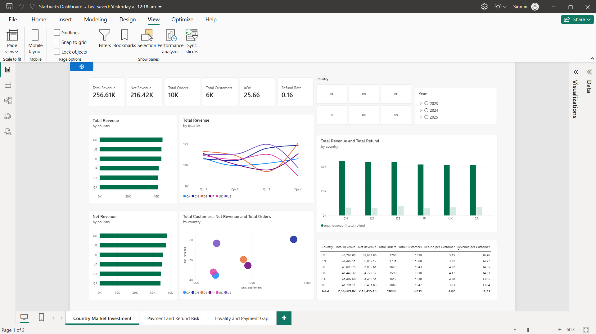
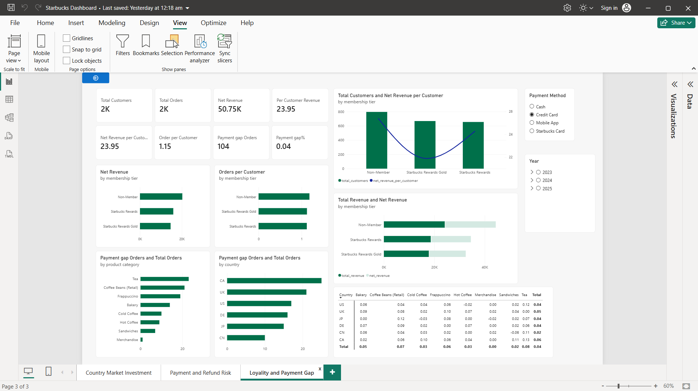
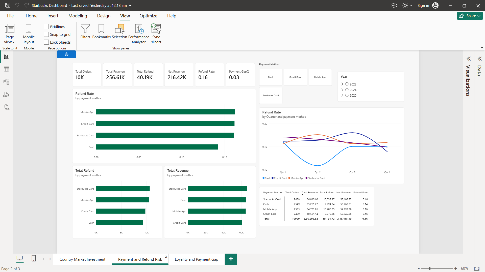

# Starbucks Revenue and Risk Analysis Dashboard (SQL + Power BI)

A three-page Power BI dashboard built on SQL data to help a finance and retail operations team decide where to invest, where payment and refund risk sits, and which loyalty tier brings the most value.





## Business Problem
The VP of Finance and Global Retail Operations needs answers to four questions. This project is a case-study scenario built around the dataset:
1. Which of the 6 country markets deserve the most marketing and store investment?
2. Do cash or Starbucks Card customers carry more payment-gap or refund risk than credit card or mobile app customers?
3. Which loyalty tier (Non-member, Starbucks Rewards, Starbucks Rewards Gold) delivers the most net revenue?
4. How large is the gap of orders with no payment record, and does it concentrate in a particular country or product category?

A single bad order tells you nothing, but ten thousand orders tell you everything, so the dashboard looks at patterns across the whole dataset.

## Dataset
- **Size:** 10,000 customers (after removing 166 duplicate rows from 10,166)
- **Data preparation:** removed duplicate customers, replaced null values, loaded the CSV files into a SQL database (PostgreSQL), and connected it to Power BI
- **Model:** star schema with `public orders` as the fact table, linked to `public customers` and a `Date` calendar table built in DAX

## Dashboard Pages

### 1. Country Market Investment
KPI cards (Total Revenue, Net Revenue, Total Customers, Total Orders, AOV, Refund Rate), a scatter chart comparing customers, orders, and net revenue by country, revenue and net revenue by country, revenue vs. refunds, a revenue trend by country, and a table of revenue per customer and refund per customer.

### 2. Payment and Refund Risk
KPI cards (Net Revenue, Payment Gap %, Refund Rate, Total Refund), revenue, refund amount, and refund rate by payment method, and a refund-rate trend over time by payment method.

### 3. Loyalty and Payment Gap
Orders per customer and net revenue per customer by membership tier, net revenue and revenue by tier, payment gap orders by country and by product category, and a country-by-category table of payment gap %.

All pages have date and category slicers.

## Key Insights
> Fill each answer with the real numbers from your dashboard.
1. **Investment:** CN generated the most net revenue ($44,500), while CA generated the least ($41,410).
2. **Payment risk:** Mobile App had the highest refund rate (0.16%), and Cash the lowest (0.14%).
3. **Loyalty:** Non-Member customers brought the most net revenue per customer ($20,215).
4. **Payment gap:** 0.04% of orders (104 orders) have no payment record.

## Recommendations
- Prioritize marketing and store investment in CN, where net revenue per customer is highest.
- Review Mobile App refund handling, since it carries the highest refund rate.
- Investigate missing payment records in before they affect revenue reporting.

## Tools and Techniques
- **SQL (PostgreSQL)** for storing and preparing the data
- **Power BI** for modelling, DAX, and dashboard design
- **DAX measures:** total customers, total orders, quantity sold, total revenue, total refund, refund rate, AOV, net revenue, net revenue rate, payment records, payment gap orders, payment gap %, paid orders, orders per customer, and net revenue per customer

## Sample DAX
```DAX
Net Revenue = [total_revenue] - [total_refund]
Payment Gap % = DIVIDE([payment_gap_orders], [total_orders], 0)
```

## Repository Structure
- `Data/` source CSV files
- `Postgres Queries` SQL queries used to prepare the data
- `Screenshots/` dashboard images
- `Starbucks_Dashboard.pbix` Power BI file
- `README.md`

## How to Use
Download the `.pbix` file and open it in Power BI Desktop (free, Windows only). Use the slicers to filter by date, country, and payment method.

## Author
Pranjal Chauhan | [LinkedIn](http://www.linkedin.com/in/pranjal-chauhan-34a7b3252) | pranjalchauhantech@gmail.com
